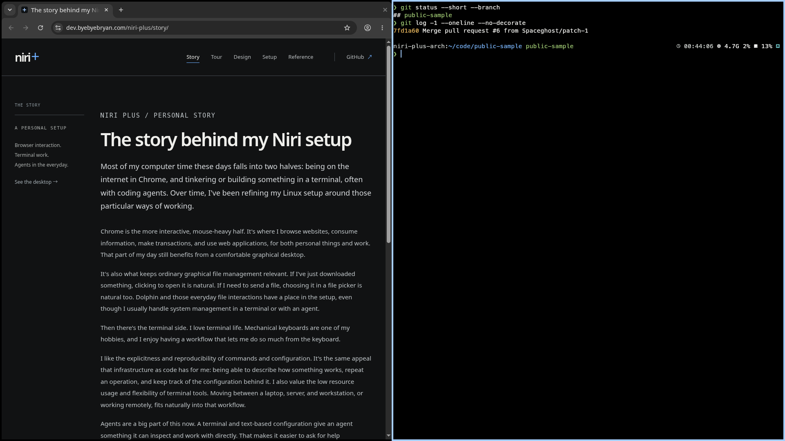

# Neutral Slate

Neutral Slate pairs warm-charcoal UI surfaces with a pure-black workspace and
Balanced+ terminal. Clear Blue marks focus and selection; status colors and
normal/bright terminal pairs stay distinct. Noto Sans UI and Meslo terminal
typography remain.

This identity is installed on Carbon, Starship and Snap through components
0.4.1. The [deployment record](reference.md#working-setup) distinguishes
installed checks from physical display and normal-use acceptance. The gallery
below uses sample content.

The [contrast study](design/contrast.md) retains the preceding desktop baseline
and terminal comparisons. Balanced+ and the crisper desktop are selected; the
other terminal options remain references.

## Direct device controls

The [interactive controls illustration](../design/rofi-controls/index.html)
shows Network, Audio and Bluetooth in the shared Plus frame: green current
device framing, independent blue keyboard selection, explicit state labels,
and an action strip separated from status. The illustration uses fictional,
stateful sample devices. The [controls recipe](recipes/rofi-controls.md)
explains the native focused-device workflow and its current acceptance boundary.

## Desktop overview

The browser and terminal share the screen over an opaque black background,
with the focused window marked by a clear border. There is no permanent bar.
This HTML/CSS composition uses sample content.

<!-- niri-plus:overview -->
The overview shows browser work beside a terminal, with focus on the terminal.
It is an illustration; no desktop action is performed.
<!-- /niri-plus:overview -->

The frame below shows the current desktop running in the staged Arch reference:
Chrome beside Kitty/Zsh, with a black workspace and the selected native theme.
It uses public content and a guest sample project. [Watch the desktop overview](tour.md#native-reference-demo)
or explore the earlier [browser/files](tour.md#browser-and-files),
[terminal](tour.md#terminals-and-agents), and
[information/clipboard](tour.md#information-when-i-want-it) recordings.

*Native staged Arch guest · components 0.4.1 · public sample content.
[Capture details and review status](planning/black-workspace-receipt.md#media-and-publication).*

## Surface gallery

Inspect Launch, Information, Terminal, and Login/lock. The examples show a
selected row, named picker actions, panel hardware states, a terminal selection,
and transient feedback. All values are fictional, and controls change these
illustrations only. Readable content remains available without JavaScript.

<!-- niri-plus:gallery -->
The gallery shows a launcher, an information panel, a terminal, and neutral
login/lock surfaces. All content is an illustration with fictional values.
<!-- /niri-plus:gallery -->

## Palette

The workspace background uses `#000000`. The overview places those black
workspaces against a charcoal `#111213` surround, keeping empty workspace
boundaries visible. UI canvas, panels and raised controls retain their own
warm-charcoal roles. Login and lock surfaces retain their neutral secure palette.

The desktop palette names each color's job. The terminal has independent
background, foreground, cursor, selection, and sixteen ANSI values. Its error,
success, warning, and blue families relate to the desktop without sharing exact
values. Normal and bright entries have deliberate shade separation.

<!-- niri-plus:palette -->
The swatches list the selected Neutral Slate roles. The terminal uses a complete
sixteen-color ANSI table.
<!-- /niri-plus:palette -->

## Typography and details

Noto Sans is used for UI text; MesloLGS Nerd Font keeps terminal characters and
symbols together. Source Han Sans CN is the CJK fallback. The specimen shows
Latin, Chinese, terminal glyphs, selected text, and the shared spacing and focus
details. It illustrates the selected design; native toolkit rendering can vary.

<!-- niri-plus:typography -->
Noto Sans is the UI face; MesloLGS Nerd Font is the terminal face. Source Han
Sans CN is the CJK fallback.
<!-- /niri-plus:typography -->

## Use the theme

The selected [identity profile source](https://github.com/byebyebryan/niri-plus/blob/main/design/identity.json)
generates the public [identity export](../data/identity.json), the site's
[appearance CSS](../assets/identity.css), palette specimen, and the
[Neutral Slate Kitty fragment](../examples/kitty/neutral-slate.conf). The
[appearance recipe](recipes/appearance.md) links to frozen Niri, Rofi, SwayNC,
Gtklock, Qt, and KDE examples. They contain appearance settings only; Kitty
input, paste, glyph, session behavior, and other component actions retain their
existing owners.

Start with the [setup guide](setup.md), then use the
[Kitty and Zsh guide](recipes/terminal.md) for terminal colors and typography.
The [architecture guide](architecture.md) and
[desktop reference](reference.md) describe component ownership and everyday
entry points. The gallery is a design specimen and does not claim to be a
recording of the deployed desktop.
