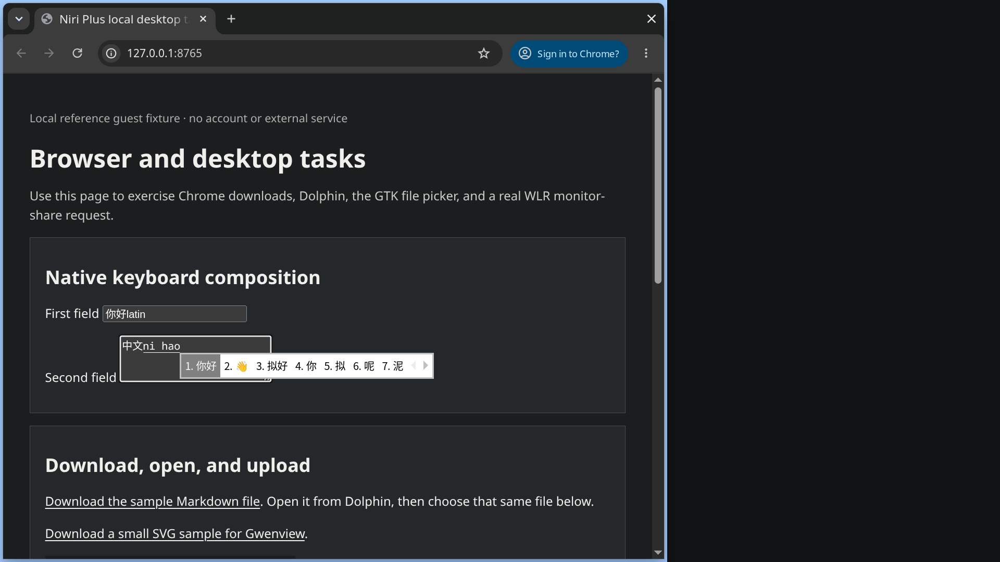

# Keyboard, languages and candidate text

Niri owns keyboard and pointer routing; Fcitx5 owns text composition. The
reference profile uses the US keyboard and Pinyin, with `Super+Space` toggling
between Pinyin and Latin. Do not use `Ctrl+Space`; it conflicts with the shell
workflow.

## Install and start the packaged owner

The main Arch walkthrough installs these packages. If following this recipe
alone, install them as an ordinary package transaction:

```sh
sudo pacman -S --needed \
  fcitx5 fcitx5-chinese-addons fcitx5-configtool fcitx5-gtk fcitx5-qt \
  adobe-source-han-sans-cn-fonts
```

Arch's Fcitx package supplies an XDG autostart entry. Niri's packaged session
starts `xdg-desktop-autostart.target`, which owns the generated
`app-org.fcitx.Fcitx5@autostart.service`. Let that owner start Fcitx5; do not
add `fcitx5 -d` to Niri or create a second user unit.

After logging into Niri, check that the packaged unit is active and exactly one
daemon is running:

```sh
systemctl --user is-active \
  niri.service graphical-session.target xdg-desktop-autostart.target \
  app-org.fcitx.Fcitx5@autostart.service
pgrep -ax fcitx5
```

If the autostart unit is absent or inactive, inspect the installed desktop entry
and `xdg-desktop-autostart.target`; inspect its user journal with
`journalctl --user -b -u app-org.fcitx.Fcitx5@autostart.service`. Log out and
back in after installing packages. Do not mask an autostart gap with a second
startup command.

## Create the reference profile

For a new account with neither configuration file present, stop the packaged
owner before writing the reference profile. This prevents a running daemon
from overwriting the files with its cached settings. The package and user
manager reload from the main walkthrough must already be complete:

```sh
if [ -e "$HOME/.config/fcitx5/profile" ] || [ -L "$HOME/.config/fcitx5/profile" ] ||
   [ -e "$HOME/.config/fcitx5/config" ] || [ -L "$HOME/.config/fcitx5/config" ]; then
  printf '%s\n' 'Existing Fcitx configuration: use fcitx5-configtool and preserve its other settings.'
else
  systemctl --user stop app-org.fcitx.Fcitx5@autostart.service
  mkdir -p "$HOME/.config/fcitx5"
  cat > "$HOME/.config/fcitx5/profile" <<'EOF'
[Groups/0]
Name=Default
Default Layout=us
DefaultIM=pinyin

[Groups/0/Items/0]
Name=keyboard-us
Layout=

[Groups/0/Items/1]
Name=pinyin
Layout=

[GroupOrder]
0=Default
EOF
  cat > "$HOME/.config/fcitx5/config" <<'EOF'
[Hotkey/TriggerKeys]
0=Super+space
EOF
  systemctl --user start app-org.fcitx.Fcitx5@autostart.service
fi
```

For an existing profile, run `fcitx5-configtool`. In the input-method list, retain `Keyboard - English
(US)` (`keyboard-us`) and add `Pinyin` (`pinyin`). Set the default keyboard
layout to `us`, make Pinyin the group's default input method, and set the global
input-method trigger to `Super+Space`. The config tool writes the complete
profile under `~/.config/fcitx5/profile`; its relevant values are:

```ini
[Groups/0]
Name=Default
Default Layout=us
DefaultIM=pinyin

[Groups/0/Items/0]
Name=keyboard-us

[Groups/0/Items/1]
Name=pinyin
```

Use the configuration tool to change an existing profile so other groups and
engine settings remain intact. Keep dictionaries and input history local to
the account.

## Session environment

Merge these values into the existing Niri `environment` block, creating one
top-level block if the starter has none:

```kdl
environment {
    QT_IM_MODULE "fcitx"
    XMODIFIERS "@im=fcitx"
    SDL_IM_MODULE "fcitx"
}
```

`QT_IM_MODULE=fcitx` selects Fcitx's Qt input module for Qt applications in
this non-KWin session. `XMODIFIERS=@im=fcitx` connects XIM clients running
under X11 or XWayland. `SDL_IM_MODULE=fcitx` is for SDL2 applications; keep it
when those clients are part of the account's workflow. These entries apply to
applications launched directly by Niri. They do not alter the user manager's
environment; a systemd-started Qt or XIM application that needs them must get
its own unit environment or a matching `environment.d` entry, followed by a
user-manager reload and application restart. `QT_IM_MODULE` is separate from
`QT_QPA_PLATFORMTHEME`, which the appearance recipe uses to select Qt styling.

Leave `GTK_IM_MODULE` unset globally. Fcitx's Wayland guide recommends GTK's
built-in Wayland input path for GTK3/4 clients; setting the module globally can
override that route. The guide also describes the XIM and Qt module roles above:
[Fcitx5 on Wayland](https://fcitx-im.org/wiki/Using_Fcitx_5_on_Wayland/en).
Validate the complete Niri config after merging the environment values, then
reload the config or start a new session and relaunch affected applications.

```sh
niri validate --config "$HOME/.config/niri/config.kdl"
```

## Optional Classic UI scaling

The public Classic UI example sets automatic Wayland DPI and enables fractional
scaling. The native Chrome and Kitty checks below already worked at scale 1.5
without this override, so treat it as an optional Classic UI adjustment if its
candidate panel has a separate scaling problem:

```sh
if [ -e "$HOME/.config/fcitx5/conf/classicui.conf" ] ||
   [ -L "$HOME/.config/fcitx5/conf/classicui.conf" ]; then
  printf '%s\n' 'Existing Classic UI config: merge the two optional keys below.'
else
  install -Dm644 "$SOURCE/examples/input/classicui.conf" \
    "$HOME/.config/fcitx5/conf/classicui.conf"
fi
```

If the target already exists, merge only these keys instead of replacing its
other appearance choices:

```ini
ForceWaylandDPI=0
EnableFractionalScale=True
```

## Verify native composition

For Kitty, confirm the tested version and open a line-input field:

```sh
kitty --version
python3 -c 'print(repr(input()))'
```

Kitty 0.49.2 used its native Wayland `text-input-v3` route without an
input-method launch flag. Switch to Pinyin with `Super+Space`, type `ceshi`,
and press Escape to cancel. Then type `nihao`, use Down/Up to choose a
candidate, press Space to commit, switch back to Latin with `Super+Space`, and
type `latin`. After Enter, verify the program received exactly `你好latin`;
this checks composed keystrokes rather than pasted Unicode. Repeat at the
supported 1.5 output scale and confirm that the candidate popup follows the
cursor and remains readable.

For Chrome 156, launch the tested native Wayland route:

```sh
google-chrome-stable --ozone-platform=wayland
```

Use a text field and a second textarea. Test preedit, Escape cancellation,
Down/Up candidate selection, Space commit, and `Super+Space` Latin switching.
The tested first field returned `你好latin`; the second committed `中文`. At
scale 1.5, the candidate popup followed the second field and composition
returned `中文你好`. This route needed no `--enable-wayland-ime`,
`--wayland-text-input-version`, `--gtk-version`, `GTK_IM_MODULE`, or
per-application Fcitx override. Keep Chrome on this native route; do not add
legacy flags based on older Chromium guidance.



Fresh E3 replay, staged Arch guest, captured 2026-10-28 at scale 1.5. Chrome is
showing the local `127.0.0.1` reference fixture, not a remote page or account;
the candidate popup is the live Fcitx interface in a real Chrome text area, not
a mockup. The [installation receipt](../planning/arch-installation-receipt.md)
records the native composition checks and their scope. See the
[media provenance](../../assets/provenance.json) and
[license notes](../../assets/LICENSES.txt) for source and attribution.

These checks passed again through the fresh installation replay with Niri
26.04, Fcitx5 5.1.23, Kitty 0.49.2, and Chrome 156.0.8078.47. Kitty returned
`你好latin` at scale 1 and `中文latin` at scale 1.5; Chrome returned `你好latin`
and `中文你好`. The profile retained one packaged autostart owner. These results
do not establish every GTK/Qt/XWayland client or physical display combination.

To recover, restore only the Niri environment entries and any optional
`classicui.conf` values you changed. Keep the generated profile, dictionaries,
and history unless you intend to remove them.
