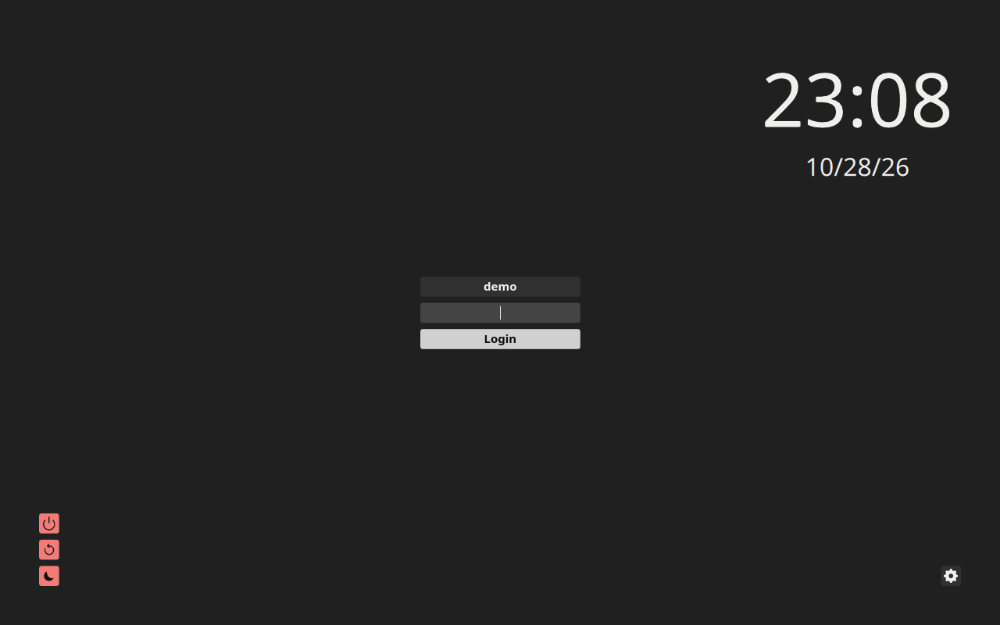

# Login and the neutral greeter

SDDM starts the Niri session; Gtklock locks an already running session. They
have separate authentication owners. The display-manager theme is system-owned;
the [Gtklock stylesheet](../../examples/theme/gtklock.css) is a user-session
appearance file.

## Pass the stock password-login gate first

On Arch, install SDDM, Niri, and the Qt6 pieces used by the greeter. The main
[Arch walkthrough](../setup.md) also installs Noto fonts, Breeze cursors,
portals, and the Niri starter. SDDM pulls its Xorg server/authentication
dependencies; KWin is not required for this reference.

```sh
sudo pacman -S --needed sddm niri qt6-declarative qt6-svg
```

From a local console, verify that no other display manager owns the login path,
then enable SDDM. Keep the distribution's current PAM files and default target:

```sh
systemctl is-enabled display-manager.service
sudo systemctl enable sddm.service
sudo systemctl start sddm.service
```

Select Niri and enter the ordinary account password. Verify the session, log out
to the greeter, and password-login once more before installing a theme:

```sh
systemctl --user is-active niri.service graphical-session.target
loginctl show-session "$XDG_SESSION_ID" -p Type -p State
```

If the stock greeter or login fails, return to the console and inspect
`journalctl -b -u sddm.service`. Do not add autologin, alter PAM, or change the
systemd default target to make this first login pass. On the development copy,
stock SDDM password authentication and Niri startup passed before appearance
changes. A later login with the packaged KWallet PAM service wired to the
graphical session unlocked KWallet and passed a disposable Secret Service
store/lookup; repeat that path after a cold boot before accepting it.

## Derive a theme preview from pinned inputs

The upstream input is the standalone Catppuccin SDDM theme, version 1.1.2,
Mocha Blue. Niri Plus derives neutral colors from this separate archive. Its
SHA-256 is
`a68fbed896d3066aec1fdaded561e8d20c855f0de4e193bdca4bc0d59ac1e333`. Use the
verified helper output at `$STAGE` from the
[Arch walkthrough](../setup-agent.md#2-stage-the-reviewed-inputs):

```sh
set -eu
mkdir -p "$HOME/.local/share/niri-plus"
WORK=$(mktemp -d "$HOME/.local/share/niri-plus/sddm-preview.XXXXXX")
curl --fail --location --output "$WORK/upstream.zip" \
  https://github.com/catppuccin/sddm/releases/download/v1.1.2/catppuccin-mocha-blue-sddm.zip
printf '%s  %s\n' \
  a68fbed896d3066aec1fdaded561e8d20c855f0de4e193bdca4bc0d59ac1e333 \
  "$WORK/upstream.zip" | sha256sum --check
unzip -q "$WORK/upstream.zip" -d "$WORK/upstream"
GENERATED_THEME=$(python3 "$STAGE/source/examples/login/derive-theme.py" \
  "$WORK/upstream/catppuccin-mocha-blue" "$WORK/derived" \
  --identity "$STAGE/source/design/identity.json")
case "$GENERATED_THEME" in
  "$WORK"/derived/*) ;;
  *) printf '%s\n' 'Generated theme path escaped its preview directory.' >&2; exit 1 ;;
esac
test -d "$GENERATED_THEME"
test -f "$GENERATED_THEME/Main.qml"
printf 'Generated theme: %s\n' "$GENERATED_THEME"
```

The helper reads the independently pinned schema-2 identity and writes a new
preview directory. It does not install the theme or control SDDM. Preview the
generated directory in a separate test display:

```sh
/usr/bin/sddm-greeter-qt6 --test-mode --theme "$GENERATED_THEME"
```

Inspect readable fields, focus, errors, font fallback, and cursor scaling. Test
mode is appearance evidence, not PAM, password, or wallet acceptance.

## Install only after the preview passes

Use a new theme directory and retain the existing theme and SDDM override. The
example below assumes no theme directory already occupies this path:

```sh
THEME_DIR=/usr/local/share/sddm/themes/niri-plus-neutral-slate
if [ -e "$THEME_DIR" ] || [ -L "$THEME_DIR" ]; then
  printf '%s\n' 'Theme path already exists; keep it and choose a new directory.'
else
  sudo install -d -o root -g root -m 0755 "$THEME_DIR" &&
  sudo cp -R "$GENERATED_THEME"/. "$THEME_DIR"/ &&
  sudo chown -R root:root "$THEME_DIR"
fi
```

For the fresh reference account, create the following new root-owned override
only when the destination is absent. Inspect existing SDDM files first;
`/etc/sddm.conf` can override values under `/etc/sddm.conf.d`. On an existing
installation, retain a copy and merge only these keys instead:

```sh
if sudo test -e /etc/sddm.conf.d/90-niri-plus.conf ||
   sudo test -L /etc/sddm.conf.d/90-niri-plus.conf; then
  printf '%s\n' 'Existing SDDM override: capture its preimage and merge the appearance keys.'
else
  sudo install -d -o root -g root -m755 /etc/sddm.conf.d
  sudo install -o root -g root -m644 /dev/stdin /etc/sddm.conf.d/90-niri-plus.conf <<'EOF'
[General]
InputMethod=

[Theme]
ThemeDir=/usr/local/share/sddm/themes
Current=niri-plus-neutral-slate
CursorTheme=breeze_cursors
CursorSize=24
Font=Noto Sans
EOF
fi
```

The managed appearance leaves `[General] InputMethod=` empty for a physical
keyboard login. Keep the current value if an on-screen keyboard is required.
Do not restart SDDM while using the desktop. Reboot or use a planned login
opportunity to test the real greeter, password login, logout, and return to
SDDM, then retain the prior theme for recovery.

The second fresh replay returned to this installed greeter after reboot:



Fresh E3 replay, staged Arch guest, captured 2026-10-28 after reboot. The
[installation receipt](../planning/arch-installation-receipt.md) records the
native password-login and wallet checks; this still shows the real greeter, not
the separate test-mode preview. See the [media provenance](../../assets/provenance.json)
and [license notes](../../assets/LICENSES.txt) for the still's source and
attribution.

## Wallet and Secret Service wiring

Keep SDDM's installed PAM stack. The development copy's packaged PAM file
already had optional `pam_kwallet5` auth/session entries, and password login
unlocked the wallet. The `kwallet-pam` package supplies
`plasma-kwallet-pam.service`; Niri's user service can start it after the
graphical session is ready:

Inspect this user-unit drop-in path first. If it exists, merge the two
ordering lines instead of replacing its other settings.

```sh
mkdir -p "$HOME/.config/systemd/user/plasma-kwallet-pam.service.d"
cat > "$HOME/.config/systemd/user/plasma-kwallet-pam.service.d/session.conf" <<'EOF'
[Unit]
After=graphical-session.target
Requisite=graphical-session.target
EOF
systemctl --user add-wants niri.service plasma-kwallet-pam.service
systemctl --user daemon-reload
```

Log out and password-login again after installing `kwallet-pam` and adding the
unit dependency. Starting the unit in the earlier session cannot recreate the
PAM password handoff. Follow the main walkthrough's fresh-login gate before
storing the disposable test secret, retain it across the next cold login, and
clear it only after that lookup succeeds.

For this reference backend, merge `org.freedesktop.impl.portal.Secret=kwallet;`
into the `[preferred]` section of the Niri portal configuration. On the
development copy, `ksecretd` owned both the Secret Service and KWallet portal,
and a disposable `secret-tool` store/lookup succeeded without another password
prompt. Check the service and bus owners after login, then erase the disposable
secret. Repeat after a cold boot before accepting the full login/wallet loop.
Never copy a private host's PAM file or wallet data.

To undo the appearance selection, restore the captured SDDM override and keep
the previous theme available. Gtklock authentication and lock-service lifetime
remain with the [session recipe](session.md).
