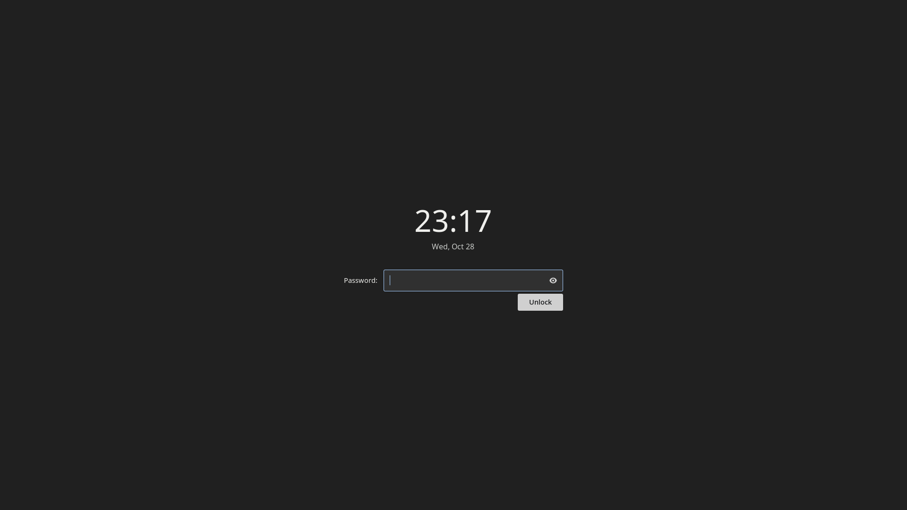

# Locking and session services

The desktop uses small user services for manual locking, idle behavior,
authorization, and battery monitoring. Each job has an owner and an independent
configuration lifetime.

## Manual locking

My setup selects Gtklock. A dedicated `desktop-lock.service` owns the active
locker, so reloading idle policy does not stop it and repeated lock requests
reuse the same service.

On Arch, install `gtklock` and `python` (needed by the readiness helper):

```sh
sudo pacman -S --needed gtklock python
```

Review the
[example service](../../examples/session/desktop-lock.service), and check your
distribution's Gtklock PAM setup before relying on it. Do not replace your
existing working lock path until you have checked authentication and all
connected displays.



Fresh E3 replay, staged Arch guest, captured 2026-10-28 before entering a
password. The [installation receipt](../planning/arch-installation-receipt.md)
records the tested wrong-password rejection, unlock, and session-lock listener;
this still documents the running lock surface. See the
[media provenance](../../assets/provenance.json) and
[license notes](../../assets/LICENSES.txt) for source and attribution.

The existing path is an authored portable profile. The generated [minimal Niri
profile](../../examples/session/profiles/minimal-niri/desktop-lock.service)
matches the selected session unit and Gtklock executable.

After reviewing both files, install the helper and unit from the clone:

```sh
mkdir -p ~/.local/bin ~/.config/systemd/user
install -m 755 examples/session/desktop-session-ready ~/.local/bin/desktop-session-ready
cp examples/session/desktop-lock.service ~/.config/systemd/user/
systemd-analyze --user verify ~/.config/systemd/user/desktop-lock.service
systemctl --user daemon-reload
```

The helper checks the captured Wayland socket before starting the locker. Add
this Niri binding once the service is configured. Replace an existing
`Ctrl+Alt+Delete` binding if present; Niri's default configuration uses that key
to quit the session:

```kdl
Ctrl+Alt+Delete { spawn "systemctl" "--user" "start" "desktop-lock.service"; }
```

The example is a manual lock path. Handling `loginctl lock-session` requires an
idle listener such as swayidle, in addition to the lock service.

## Idle policy is a choice

For unattended SSH/browser-agent work, the optional
[manual display-away companion](away-mode.md) can keep displays off until input
returns, independently of the automatic idle policy described below.
Use its explicit resume command only for an explicit away latch; do not connect
`desktop-away resume` to swayidle's automatic resume event.

My current machines power off displays after ten minutes. Battery suspend is
after thirty minutes, with no automatic suspend on external power. Automatic
locking and lock-before-suspend are disabled in my personal policy.

The [full policy example](../../examples/session/power.toml.example) expresses
those choices in seconds; zero disables an automatic timeout. It also enables
`loginctl` lock requests and critical-battery warnings at 10%. Review the values
before installing them. The Session menu and idle helper read the same
`desktop-session/power.toml`; keep one file with the full set of fields when
using both. The shorter utility-only example supplies just the Session setting.

## Install idle and battery wiring

The frozen [desktop-power helper](../../examples/session/desktop-power) owns two
independent services: [idle](../../examples/session/desktop-idle.service) and
[battery warnings](../../examples/session/desktop-battery.service). It uses
Python 3.11+, `swayidle`, Niri, systemd, UPower and `notify-send`. On Arch:

```sh
sudo pacman -S --needed python swayidle upower libnotify
install -Dm755 examples/session/desktop-power "$HOME/.local/bin/desktop-power"
install -Dm644 examples/session/desktop-idle.service "$HOME/.config/systemd/user/desktop-idle.service"
install -Dm644 examples/session/desktop-battery.service "$HOME/.config/systemd/user/desktop-battery.service"
```

Install the readiness helper and working lock service above first. After
reviewing existing configuration, install or merge the full policy at
`~/.config/desktop-session/power.toml`. The helper refuses missing/invalid fields;
it does not invent an idle policy. Its `locker` key records the chosen locker,
while `desktop-lock.service` owns the actual executable.

Inspect existing idle owners and remove only their startup mechanism when you
are ready to hand over. Keep their configuration for recovery. The public
example assumes Niri started through `niri-session` or a display manager, with
`niri.service` and `graphical-session.target` active. Following
[Niri's systemd integration](https://niri-wm.github.io/niri/Example-systemd-Setup.html),
wire the two units into that session:

```sh
systemd-analyze --user verify ~/.config/systemd/user/desktop-idle.service ~/.config/systemd/user/desktop-battery.service
systemctl --user daemon-reload
systemctl --user add-wants niri.service desktop-idle.service desktop-battery.service
systemctl --user start desktop-idle.service desktop-battery.service
```

Their `PartOf`/`Requisite` settings tie them to the graphical session. Do not
also spawn `desktop-power` or another swayidle instance from Niri. The manual
lock unit is started on demand; it is not enabled as a startup lock.

## Understand the policy transitions

The helper checks system-battery/AC state every five seconds, ignoring USB
peripheral batteries. A source change replaces only its swayidle child and
registers the applicable AC or battery timers again. A timeout rechecks the
power source before requesting suspend. Display-off and resume use Niri's own
monitor power actions. Automatic lock timers and lock-before-suspend remain
separate settings; manual locks use the independent lock service.

Battery warnings read UPower's display device every thirty seconds. They alert
once below the configured threshold while discharging and rearm after charging
or recovery above its hysteresis. They do not implement a critical-battery
shutdown action. Missing batteries and unavailable readings are handled without
inventing a percentage.

[swayidle](https://github.com/swaywm/swayidle) handles compositor idle events and
logind sleep coordination. Lid policy and other system sleep owners remain
outside these user units. Inspect `systemd-inhibit --list` when investigating
sleep inhibition; check actual browser playback/call behavior and a scheduled
suspend/resume on the target host. A configured timer alone does not establish
that every application's inhibition behavior has been accepted.

Power profiles have a separate owner, `power-profiles-daemon`. Where installed,
`powerprofilesctl list` and `powerprofilesctl get` inspect supported profiles and
the current selection. Use only a profile reported by the platform when making
an explicit change. The idle helper and Session menu leave that selection alone;
the normal entry point is the terminal or an agent.

## Authorization and the graphical session

An authorization agent is still needed for applications that request elevated
permissions. My setup uses polkit-kde-agent, started after the Wayland socket is
ready. It belongs to the Niri session and stops with the graphical session.

On Arch, install `polkit-kde-agent` and inspect its packaged unit:

```sh
systemctl --user cat plasma-polkit-agent.service
```

The [session drop-in](../../examples/session/polkit-session.conf) adds the
captured Wayland-socket condition and graphical-session dependency to that
packaged unit. Install it at
`~/.config/systemd/user/plasma-polkit-agent.service.d/session.conf`, retaining
other drop-ins. Reload the user manager, then add this unit to Niri's wants and
start it once the session is ready:

```sh
systemctl --user daemon-reload
systemctl --user add-wants niri.service plasma-polkit-agent.service
systemctl --user start plasma-polkit-agent.service
```

Use the package's supported executable/unit on other distributions and follow
[Niri's authorization guidance](https://niri-wm.github.io/niri/Important-Software.html).
Keep PAM and the existing wallet/secret backend unchanged. The
[login recipe](login.md) covers the separate SDDM ownership boundary.

## Inspect before changing

Useful read-only checks include:

```sh
systemctl --user status graphical-session.target niri.service
systemctl --user cat desktop-lock.service
systemctl --user status desktop-lock.service
loginctl show-session self -p Type -p State
```

Check manual locking and unlock on your own machine, then test the idle behavior
you selected. Inspect `journalctl --user -u desktop-idle -u desktop-battery` for
policy transitions and unavailable battery readings. Check an ordinary AC/battery
transition and display wake; schedule suspend/resume separately.

To roll back, stop only the idle/battery units you introduced and remove only
their newly created `niri.service.wants` links, then restore the prior startup,
units, policy and helpers. Treat the polkit drop-in/link separately and retain a
working authorization agent. Do not stop `desktop-lock.service` during an active
lock. The [isolated example check](../../scripts/check-desktop.py) tests policy
and command construction without locking, suspending or sending notifications.
