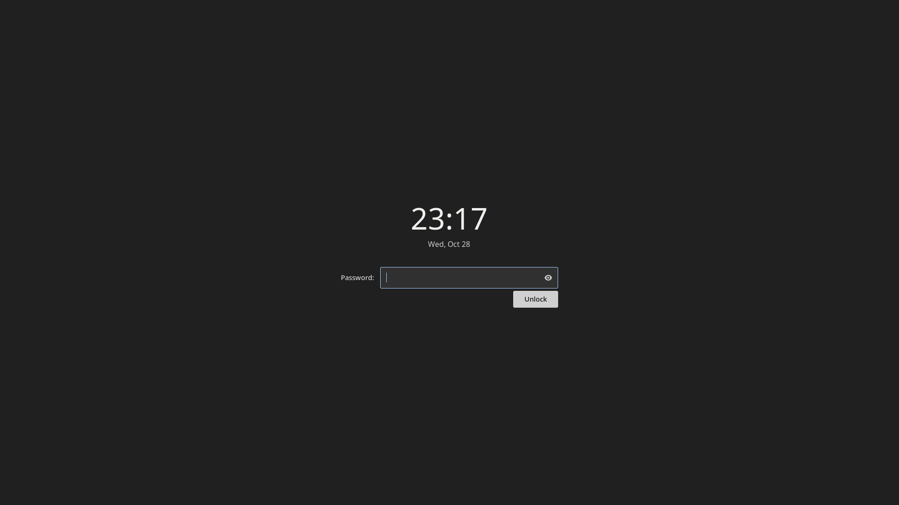

# Locking and session services

The desktop uses small user services for manual locking, idle behavior,
authorization, and battery monitoring. Each job has an owner and an independent
configuration lifetime.

## Manual locking

My setup selects Gtklock. A dedicated `desktop-lock.service` owns the active
locker, so reloading idle policy does not stop it and repeated lock requests
reuse the same service.

On Arch, install `gtklock` and `python` (needed by the readiness helper):

```sh
sudo pacman -S --needed gtklock python
```

Review the
[example service](../../examples/session/desktop-lock.service), and check your
distribution's Gtklock PAM setup before relying on it. Do not replace your
existing working lock path until you have checked authentication and all
connected displays.



Fresh E3 replay, staged Arch guest, captured 2026-10-28 before entering a
password. The [installation receipt](../planning/arch-installation-receipt.md)
records the tested wrong-password rejection, unlock, and session-lock listener;
this still documents the running lock surface. See the
[media provenance](../../assets/provenance.json) and
[license notes](../../assets/LICENSES.txt) for source and attribution.

The existing path is an authored portable profile. The generated [minimal Niri
profile](../../examples/session/profiles/minimal-niri/desktop-lock.service)
matches the selected session unit and Gtklock executable.

After reviewing both files, install the helper and unit from the clone:

```sh
mkdir -p ~/.local/bin ~/.config/systemd/user
install -m 755 examples/session/desktop-session-ready ~/.local/bin/desktop-session-ready
cp examples/session/desktop-lock.service ~/.config/systemd/user/
systemd-analyze --user verify ~/.config/systemd/user/desktop-lock.service
systemctl --user daemon-reload
```

The helper checks the captured Wayland socket before starting the locker. The
qualified reference uses this lock-only binding. Replace an existing
`Ctrl+Alt+Delete` binding if present; Niri's default configuration uses that key
to quit the session:

```kdl
Ctrl+Alt+Delete { spawn "systemctl" "--user" "start" "desktop-lock.service"; }
```

For the optional unified screen below, replace this binding with its profile;
keep only one Ctrl+Alt+Delete entry. The example is a manual lock path. Handling `loginctl lock-session` requires an
idle listener such as swayidle, in addition to the lock service.

## Optional unified session screen

The local components 0.9.0 candidate adds a native session screen without
changing the published 0.8.1 selection or the qualified 0.4.1 reference.
`desktop-session-menu --screen` opens a two-row action grid on the focused
monitor; other monitors receive only a dim backdrop. The panel uses Neutral
Slate, Noto Sans and monochrome action icons, with no blur or decorative motion.

| Action | Meaning in the unified screen |
| --- | --- |
| Lock | Establish the real lock, then turn off all displays. Input wakes the locked session; authentication is still required. |
| Display off | Turn off displays without adding a lock. Input returns the displays; normal automatic policy continues. |
| Suspend | Pause the open session, retaining the existing lock-before-suspend policy. |
| Log out | End the session after the shared confirmation, without another Niri quit prompt. |
| Restart | Request native restart with its normal authorization and inhibitors. |
| Shut down | Request native power-off with its normal authorization and inhibitors. |

All six actions use **Choose → five-second cancellable countdown → request**.
The countdown is the confirmation: selecting an action starts it, and the
request runs automatically at expiry unless cancelled. Opening the grid starts
no timer. Cancel is focused during the countdown; held Enter or Space cannot
skip it or accidentally activate Cancel. Arrows navigate the grid and
Tab/Shift+Tab remain within the active screen. Cancel or Escape during the
countdown closes the screen and returns directly to the desktop, without a
result or error view. Repeating the entry raises the same screen without
resetting a pending timer. Cancellation cannot recall a native
request once dispatch has committed.

Lock and Display off have these meanings on every host. The screen does not
read the legacy `confirmation.toml` `lock_on_away` preference. Automatic idle,
lid and physical power-button policy keep their existing owners. This is an
on-demand UI, not a new startup daemon or locker.

Use Python 3.11+, GTK 3/PyGObject, GtkLayerShell, Niri IPC, the readiness helper,
a working `desktop-lock.service`, and the independently selected
[Away controller](away-mode.md). Suspend also needs the existing
`desktop-session/power.toml`. The screen does not enable or install these
providers. A missing or refused provider must be handled as an explicit error.

For a new unmanaged adoption, review this candidate checkout and preserve the
preimages of the three helper targets and the existing Niri binding first.
Finish or cancel any pending manual action with the installed helper before
replacing its files. The candidate scopes its runtime state to the captured
compositor instance; an in-flight older helper is not migrated during upgrade.
Use the reviewed current checkout here, not the numbered reference's frozen
`$SOURCE` tree:

```sh
export SESSION_SCREEN_SOURCE="$PWD"
git -C "$SESSION_SCREEN_SOURCE" rev-parse HEAD
install -Dm755 "$SESSION_SCREEN_SOURCE/examples/session/desktop-suspend" \
  "$HOME/.local/bin/desktop-suspend"
install -Dm755 "$SESSION_SCREEN_SOURCE/examples/desktop/desktop-session-menu" \
  "$HOME/.local/bin/desktop-session-menu"
install -Dm755 "$SESSION_SCREEN_SOURCE/examples/session/desktop-session-ready" \
  "$HOME/.local/bin/desktop-session-ready"
```

The generated [minimal Niri fragment](../../examples/session/profiles/minimal-niri/session-screen.kdl)
contains only the opt-in Ctrl+Alt+Delete binding. Inspect existing bindings and
includes, then either merge its single entry or install it as
`~/.config/niri/local/session-screen.kdl` and add
`include "local/session-screen.kdl"` on Niri versions supporting includes.
Validate the complete Niri configuration before using it. Do not add
`allow-when-locked`: Gtklock retains authentication and the menu must not appear
above it. Managed consumers make this choice in their configuration owner.

For direct manual shortcuts, `desktop-suspend menu --select suspend` starts
Suspend's countdown immediately. `--select` also accepts `lock`, `away`,
`logout`, `restart` and `shutdown`; every route retains the full countdown.
The screen's `--seconds` option accepts 1–60, defaulting to five. Existing `countdown`,
`cancel` and immediate `away` calls keep their compatibility behavior below.

If the system refuses a request after the countdown expires, the screen shows
the error. This is separate from cancelling a countdown. Choosing Retry starts a fresh request
and full countdown; it never retries automatically.
Partial completion must be reported accurately: Away can turn displays off
once without enforcing a latch, and a successful lock can precede failed
blanking. After actual lock ownership transfers, the screen yields to the real
locker and retains diagnostics rather than displaying a menu above it.
Display wake is separate from unlocking.

The [owned screen check](https://github.com/byebyebryan/niri-plus/blob/main/scripts/check-session-screen-native)
uses private Xvfb/nested Niri and inert lock/power/logout endpoints. Its GUI
evidence is separate from installed-consumer, genuine locker readiness and
physical panel/wake acceptance. To roll back an adoption, restore only the
reviewed helper and binding preimages; keep automatic policy and an active
locker intact.

## Optional suspend countdown

The [desktop-suspend helper](../../examples/session/desktop-suspend) provides a
five-second manual session-action countdown. It supports suspend, lock,
display-off (with optional locking), restart and shutdown. A full-screen
layer-shell surface covers each connected monitor with a 55% opaque dark tint;
the existing desktop, including full-screen applications, remains visible
beneath fully opaque host/action text, large countdown, and Escape hint. Only
the digits change; there is no decorative animation or blur.

Escape, Cancel, closing a surface, or moving focus elsewhere cancels. Repeating
the same action keeps its timer. A different action replaces the pending action
in the same overlay and starts a fresh five seconds. This lets the display-off
shortcut replace a pending suspend, restart or shutdown. The request identity is
checked again at commit, so a replaced action cannot execute at its old deadline.
A replacement arriving just as the old UI closes fails closed.

The timer starts only after every surface is mapped and the focused monitor's
surface has keyboard focus. Failed startup, an unresponsive UI, output hotplug,
or another sleep/resume transition cancels it. Other monitors show the same
countdown without taking keyboard focus.

This optional helper requires Python 3.11+, PyGObject with GTK 3 and
GtkLayerShell introspection (`python-gobject` and `gtk-layer-shell` on Arch),
Niri IPC, and the readiness helper above. Suspend also requires a working
`desktop-session/power.toml` containing the boolean `lock_before_suspend`;
that native policy is re-read at commit. No persistent service is created.
Automatic idle, loginctl locks, lid and physical power-button handling retain
their existing owners and timing.

After reviewing the helpers, install them alongside the readiness helper:

```sh
install -m 755 examples/session/desktop-suspend ~/.local/bin/desktop-suspend
install -m 755 examples/desktop/desktop-session-menu ~/.local/bin/desktop-session-menu
```

No Niri window rule is required. Remove the old `org.niri-plus.suspend`
floating-window rule when upgrading from 0.6.0. Replace existing bindings for
these keys when adopting the countdown (choose the label for this machine):

```kdl
Mod+Shift+P repeat=false { spawn "desktop-suspend" "countdown" "--seconds" "5" "--label" "My laptop"; }
Ctrl+Alt+Delete repeat=false allow-when-locked=true { spawn "desktop-suspend" "countdown" "--operation" "away" "--seconds" "5" "--label" "My laptop" "--lock"; }
```

Omit `--lock` for display-off without locking. To adopt the same overlay for the
Session menu, create `~/.config/desktop-session/confirmation.toml`:

```toml
seconds = 5
label = "My laptop"
lock_on_away = true
```

The menu retains explicit **Lock**, adds **Lock and turn off displays** (or
**Turn off displays** when `lock_on_away = false`), and routes Suspend, Restart
and Shut down through the same overlay. There is one initial menu selection
and one countdown; restart/shutdown do not add a second Rofi prompt. Log out
retains Niri's own quit confirmation. Without this optional file, the menu
retains its existing native actions and Cancel-first restart/shutdown prompt.
An invalid file cancels instead of silently bypassing the overlay.

`desktop-suspend cancel` cancels without another action. The legacy
`desktop-suspend away [--lock]` command still cancels and enters Away immediately
for older callers; new bindings should use `countdown --operation away`.
Other explicit operations are `lock`, `restart`, and `shutdown`. Once a native
transition has committed, the helper cannot recall the operating system's request.

The [native check](https://github.com/byebyebryan/niri-plus/blob/main/scripts/check-suspend-countdown-native)
runs the real overlay and Session menu dispatch in private Xvfb/nested Niri,
with unreachable private D-Bus sockets and inert power/lock/display commands.
It covers all five operations, replacements, duplicate presses, cancellation,
focus loss, menu routing, tint/opaque text and real compositor shortcuts.
Its screenshots are test-session evidence, not recordings of a deployed desktop.

## Idle policy is a choice

For unattended SSH/browser-agent work, the optional
[manual display-away companion](away-mode.md) can keep displays off until input
returns, independently of the automatic idle policy described below.
Use its explicit resume command only for an explicit away latch; do not connect
`desktop-away resume` to swayidle's automatic resume event.

My current machines power off displays after ten minutes. Battery suspend is
after thirty minutes, with no automatic suspend on external power. Automatic
locking and lock-before-suspend are disabled in my personal policy.

The [full policy example](../../examples/session/power.toml.example) expresses
those choices in seconds; zero disables an automatic timeout. It also enables
`loginctl` lock requests and critical-battery warnings at 10%. Review the values
before installing them. The Session menu and idle helper read the same
`desktop-session/power.toml`; keep one file with the full set of fields when
using both. The shorter utility-only example supplies just the Session setting.

## Install idle and battery wiring

The frozen [desktop-power helper](../../examples/session/desktop-power) owns two
independent services: [idle](../../examples/session/desktop-idle.service) and
[battery warnings](../../examples/session/desktop-battery.service). It uses
Python 3.11+, `swayidle`, Niri, systemd, UPower and `notify-send`. On Arch:

```sh
sudo pacman -S --needed python swayidle upower libnotify
install -Dm755 examples/session/desktop-power "$HOME/.local/bin/desktop-power"
install -Dm644 examples/session/desktop-idle.service "$HOME/.config/systemd/user/desktop-idle.service"
install -Dm644 examples/session/desktop-battery.service "$HOME/.config/systemd/user/desktop-battery.service"
```

Install the readiness helper and working lock service above first. After
reviewing existing configuration, install or merge the full policy at
`~/.config/desktop-session/power.toml`. The helper refuses missing/invalid fields;
it does not invent an idle policy. Its `locker` key records the chosen locker,
while `desktop-lock.service` owns the actual executable.

Inspect existing idle owners and remove only their startup mechanism when you
are ready to hand over. Keep their configuration for recovery. The public
example assumes Niri started through `niri-session` or a display manager, with
`niri.service` and `graphical-session.target` active. Following
[Niri's systemd integration](https://niri-wm.github.io/niri/Example-systemd-Setup.html),
wire the two units into that session:

```sh
systemd-analyze --user verify ~/.config/systemd/user/desktop-idle.service ~/.config/systemd/user/desktop-battery.service
systemctl --user daemon-reload
systemctl --user add-wants niri.service desktop-idle.service desktop-battery.service
systemctl --user start desktop-idle.service desktop-battery.service
```

Their `PartOf`/`Requisite` settings tie them to the graphical session. Do not
also spawn `desktop-power` or another swayidle instance from Niri. The manual
lock unit is started on demand; it is not enabled as a startup lock.

## Understand the policy transitions

The helper checks system-battery/AC state every five seconds, ignoring USB
peripheral batteries. A source change replaces only its swayidle child and
registers the applicable AC or battery timers again. A timeout rechecks the
power source before requesting suspend. Display-off and resume use Niri's own
monitor power actions. Automatic lock timers and lock-before-suspend remain
separate settings; manual locks use the independent lock service.

Battery warnings read UPower's display device every thirty seconds. They alert
once below the configured threshold while discharging and rearm after charging
or recovery above its hysteresis. They do not implement a critical-battery
shutdown action. Missing batteries and unavailable readings are handled without
inventing a percentage.

[swayidle](https://github.com/swaywm/swayidle) handles compositor idle events and
logind sleep coordination. Lid policy and other system sleep owners remain
outside these user units. Inspect `systemd-inhibit --list` when investigating
sleep inhibition; check actual browser playback/call behavior and a scheduled
suspend/resume on the target host. A configured timer alone does not establish
that every application's inhibition behavior has been accepted.

Power profiles have a separate owner, `power-profiles-daemon`. Where installed,
`powerprofilesctl list` and `powerprofilesctl get` inspect supported profiles and
the current selection. Use only a profile reported by the platform when making
an explicit change. The idle helper and Session menu leave that selection alone;
the normal entry point is the terminal or an agent.

## Authorization and the graphical session

An authorization agent is still needed for applications that request elevated
permissions. My setup uses polkit-kde-agent, started after the Wayland socket is
ready. It belongs to the Niri session and stops with the graphical session.

On Arch, install `polkit-kde-agent` and inspect its packaged unit:

```sh
systemctl --user cat plasma-polkit-agent.service
```

The [session drop-in](../../examples/session/polkit-session.conf) adds the
captured Wayland-socket condition and graphical-session dependency to that
packaged unit. Install it at
`~/.config/systemd/user/plasma-polkit-agent.service.d/session.conf`, retaining
other drop-ins. Reload the user manager, then add this unit to Niri's wants and
start it once the session is ready:

```sh
systemctl --user daemon-reload
systemctl --user add-wants niri.service plasma-polkit-agent.service
systemctl --user start plasma-polkit-agent.service
```

Use the package's supported executable/unit on other distributions and follow
[Niri's authorization guidance](https://niri-wm.github.io/niri/Important-Software.html).
Keep PAM and the existing wallet/secret backend unchanged. The
[login recipe](login.md) covers the separate SDDM ownership boundary.

## Inspect before changing

Useful read-only checks include:

```sh
systemctl --user status graphical-session.target niri.service
systemctl --user cat desktop-lock.service
systemctl --user status desktop-lock.service
loginctl show-session self -p Type -p State
```

Check manual locking and unlock on your own machine, then test the idle behavior
you selected. Inspect `journalctl --user -u desktop-idle -u desktop-battery` for
policy transitions and unavailable battery readings. Check an ordinary AC/battery
transition and display wake; schedule suspend/resume separately.

To roll back, stop only the idle/battery units you introduced and remove only
their newly created `niri.service.wants` links, then restore the prior startup,
units, policy and helpers. Treat the polkit drop-in/link separately and retain a
working authorization agent. Do not stop `desktop-lock.service` during an active
lock. The [isolated example check](../../scripts/check-desktop.py) tests policy
and command construction without locking, suspending or sending notifications.
